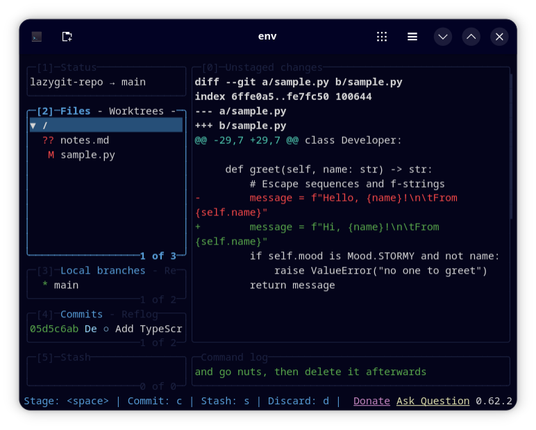

# Deepwick for lazygit

Deepwick colors for [lazygit](https://github.com/jesseduffield/lazygit).

> Deepwick is an unofficial theme derived from
> [Polywick Blue](https://vscode.polywickstudio.net) by Polywick Studio (MIT).
> Not affiliated with Polywick Studio.



## Install

Copy the `gui:` block from `deepwick.yml` into your lazygit `config.yml`
(`lazygit --print-config-dir` shows where it lives), merging with any `gui:`
settings you already have.

Or keep it separate and load both files:

```sh
export LG_CONFIG_FILE="$(lazygit --print-config-dir)/config.yml,/path/to/deepwick.yml"
```

## Notes

- Inactive panel borders use Overlay, so they recede; the focused panel is
  Blue and bold.
- All commit authors are Light Blue.

Tested with lazygit 0.62.2.

## License

MIT. See [LICENSE](LICENSE).
